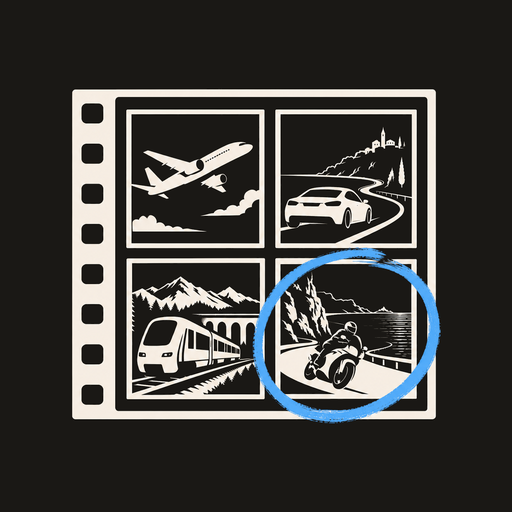
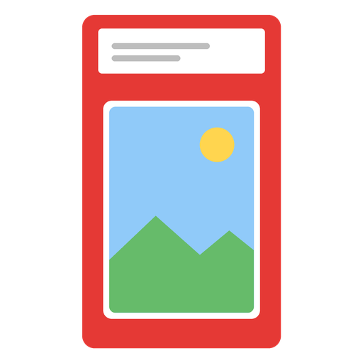

# Unraid templates

Templates for [Unraid](https://unraid.net)'s **Community Applications**.

| App | What it is |
|---|---|
|  **[Roamlight](https://github.com/Racoon80/roamlight)** | Your family's photo album on your own server — albums on a map, who-sees-what per album, share links, slideshows, an iPhone and an Android app. |
|  **[Pokemon-Extender](https://github.com/Racoon80/pokemon-extender)** | A picture of a Pokémon card in, a print-and-cut insert for a PSA- or BGS-style acrylic case out — ready for Bambu Suite and other cutters. |

## Install

Search for the app's name in the Apps tab of your Unraid server. Until it shows
up there, you can add the templates by hand: *Docker → Add Container → Template
repositories*, add

```
https://github.com/Racoon80/unraid-templates
```

save, and pick the app from the template list.

## Help

Questions about an app: its own GitHub issues, linked from the template.
A problem with a template: [this repository's issues](https://github.com/Racoon80/unraid-templates/issues).

---

<a href="https://www.buymeacoffee.com/dv7g" target="_blank"></a>
